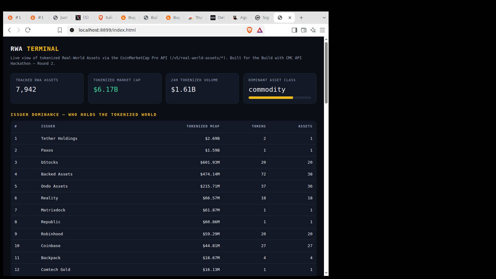

# RWA Terminal

A live view of tokenized **Real-World Assets** (tokenized stocks, commodities, treasuries, ETFs, real estate) built entirely on the **CoinMarketCap Pro API's new `/v5/real-world-assets/*` endpoint suite**.

Built for the **Build with CMC: API Hackathon — Round 2** (track: *Real World Assets*).



## What it does

**1. Static dashboard (`index.html`)** — a self-contained dark-terminal page with:
- Market overview: total tracked assets, aggregate tokenized market cap, 24h tokenized volume, dominant asset class
- **Issuer dominance table** — which issuer (Tether, Paxos, bStocks, Backed, Robinhood, Coinbase…) holds the tokenized world, ranked by aggregate tokenized market cap of their tokens
- **Top assets** by tokenized market cap, filterable by asset type (stock / commodity / currency / government_security / etf / real_estate)
- **Premium/discount scanner** — every token priced against its asset's tokenized aggregate, exposing where tokenized markets dislocate (e.g. `XAUT0 −0.96%` vs the gold aggregate while `XAUM` trades `+0.09%`)

Rebuild it live anytime:

```bash
python3 build_dashboard.py
```

**2. CLI / agent tool (`rwa_terminal.py`)** — the same data surface for terminals and LLM agents:

```bash
python3 rwa_terminal.py top --type commodity --limit 15   # ranked assets by type
python3 rwa_terminal.py spread GOLD                        # per-issuer premium/discount for one asset
python3 rwa_terminal.py issuers                            # issuer registry with token counts
python3 rwa_terminal.py status                             # plan + credit telemetry
```

## CMC API endpoints used (explicit)

| Endpoint | Purpose |
|---|---|
| `/v5/real-world-assets/assets/list` | paginated tracked RWA assets with tokenized aggregate quotes (7,900+ assets) |
| `/v5/real-world-assets/quotes/latest` | per-token + per-issuer breakdown and TradFi markets for named assets |
| `/v5/real-world-assets/issuers/list` | issuer registry with linked-token counts |
| `/v1/key/info` | plan and credit telemetry (shown in dashboard footer) |

All four run on the free **Startup tier** granted for the hackathon (15,000 credits/month, 50 req/min). The full dashboard build consumes **~5 credits**.

## Visible evidence of a real API call

Raw responses (captured 2026-11-26, from the hackathon Startup-tier key) are committed under [`data/`](data/) — see `data/evidence.md` for the exact request/response pairs, and the credits telemetry in the dashboard footer.

## What the API made possible (and where it got in the way)

**Made possible:** The `/v5` RWA suite is the only public source that aggregates *every* tokenized issuer of the same underlying asset (7 gold tokens, 10+ NVDA tokens…) into one asset record with per-token attribution. The premium/discount scanner is impossible to build from any single issuer's feed — with CMC it is one API call. `rwa_id` is a genuinely useful stable identifier.

**Got in the way:**
- `quotes/latest` rejects requests with more than ~30 comma-separated symbols in practice, so the builder batches and uses `skip_invalid=true`
- Some tokens carry prices in different denominations (e.g. gram-denominated gold tokens), which show as `−96%` "discounts" — a denomination quirk, not a real spread; a `denomination` field would fix this
- `issuers/list` gives token *counts* but not tokenized market cap per issuer — the dominance table has to be assembled by summing per-token data from `quotes/latest`

## Run it

```bash
pip install -r requirements.txt   # stdlib only — no dependencies
echo "CMC_API_KEY=your_key" > .env
python3 build_dashboard.py        # renders index.html
python3 -m http.server 8899       # view at localhost:8899
```

## License

MIT
